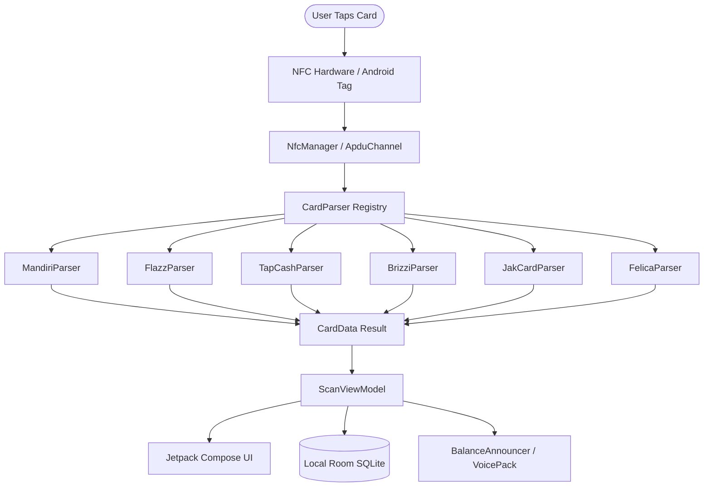

# OSP KUE Reader — Indonesian Contactless Card NFC Reader

<p align="center">
  
</p>

<p align="center">
  <strong>Fast, private, and offline Android NFC reader for Indonesian electronic money cards.</strong><br>
  Built with modern Kotlin & Jetpack Compose.
</p>

<p align="center">
  <a href="https://github.com/muhakmal/osp-kue-reader/actions/workflows/ci.yml"></a>
  <a href="LICENSE"></a>
  
  
  
  <a href="CONTRIBUTING.md"></a>
</p>

---

## 📖 Table of Contents
- [English](#-english)
  - [Overview](#overview)
  - [Supported Cards](#supported-cards)
  - [Key Features](#key-features)
  - [Architecture & Tech Stack](#architecture--tech-stack)
  - [Getting Started & Build Instructions](#getting-started--build-instructions)
  - [Privacy & Security](#privacy--security)
  - [Project Roadmap](ROADMAP.md)
  - [Disclaimer & Trademarks](#disclaimer--trademarks)
- [Bahasa Indonesia](#-bahasa-indonesia)
  - [Ikhtisar](#ikhtisar)
  - [Kartu yang Didukung](#kartu-yang-didukung)
  - [Fitur Utama](#fitur-utama)
  - [Panduan Build & Menjalankan](#panduan-build--menjalankan)

---

## 🇬🇧 English

### Overview
**OSP KUE Reader** (*Open Source Project - Kartu Uang Elektronik Reader*) is a native Android application designed to read current balances, detailed transaction histories, and card identifiers from Indonesian contactless electronic money smartcards via Near Field Communication (NFC).

The application operates **100% locally on-device**. No cardholder data, card numbers, or transaction logs are ever sent over a network.

### Supported Cards

| Card Type | Issuer | NFC Standard | Balance | History | Notes |
|:---|:---|:---:|:---:|:---:|:---|
| **Mandiri e-money** | Bank Mandiri | ISO/IEC 14443-4 (IsoDep) | ✅ | ✅ | Supports new (00 D1) & legacy records |
| **BCA Flazz (Gen 2)** | Bank Central Asia | ISO/IEC 14443-4 (IsoDep) | ✅ | ✅ | Full balance & recent transaction log |
| **BCA Flazz (Gen 1)** | Bank Central Asia | ISO/IEC 14443-4 (IsoDep) | ⚠️ Encrypted | ⚠️ Encrypted | Requires proprietary bank SAM |
| **BNI TapCash** | Bank Negara Indonesia | ISO/IEC 14443-4 (IsoDep) | ✅ | ✅ | Reads balance & terminal history |
| **BRI Brizzi** | Bank Rakyat Indonesia | ISO/IEC 14443-4 (IsoDep) | ✅ | ✅ | Standard contactless log |
| **JakCard** | Bank DKI | ISO/IEC 14443-4 (IsoDep) | ✅ | ✅ | Jakarta transit & toll card |
| **KMT (Kartu Multi Trip)**| PT Kereta Commuter Indonesia | JIS X 6319-4 (FeliCa) / Mifare | ✅ | ✅ | Commuter Line & MRT Jakarta |

### Key Features
- **⚡ Instant Tap-to-Read**: Low-latency APDU transceive logic with robust error handling and haptic feedback.
- **🔊 Voice Pack Announcements**: Spoken balance announcements upon card tap in natural Indonesian accents (custom voice engine).
- **📊 Local Expense Analytics & History**: Automatic classification of toll, transit, and retail transactions stored securely in a local Room database.
- **🛣️ Toll Fare Estimator**: Integrated Indonesian toll expressway rate database for trip budgeting.
- **🎨 Modern Material 3 UI**: Clean, expressive user interface powered by Jetpack Compose with Dark/Light theme switching.
- **📲 Home Screen Widget & Quick Tile**: Quick-access shortcuts to initiate NFC scans directly from the Android Quick Settings panel.

### Architecture & Tech Stack
- **UI**: Jetpack Compose, Material 3, Lottie Compose Animations
- **Core Language**: Kotlin 2.0 (Coroutines, StateFlow)
- **NFC Engine**: `android.nfc` API with decoupled `ApduChannel` transceivers
- **Database**: Room (SQLite) with schema migration testing
- **DI & Structure**: Clean MVVM / Unidirectional Data Flow pattern



### Getting Started & Build Instructions

#### Prerequisites
- **JDK 17 or 21**
- **Android SDK** (API 36, Android Build Tools 36+)
- **Android Device** with NFC support (Android 7.0 / API 24+)

#### Cloning & Building
```bash
# 1. Clone this repository
git clone https://github.com/muhakmal/osp-kue-reader.git
cd osp-kue-reader

# 2. Run unit tests
./gradlew testDebugUnitTest
# or: make test

# 3. Build Debug APK
./gradlew assembleDebug
# or: make build
```
The output APK will be placed at:  
`app/build/outputs/apk/debug/app-debug.apk`

---

## 🇮🇩 Bahasa Indonesia

### Ikhtisar
**OSP KUE Reader** adalah aplikasi Android native sumber terbuka (*open source*) untuk membaca sisa saldo, riwayat transaksi, dan nomor kartu uang elektronik Indonesia (e-money, Flazz, TapCash, Brizzi, JakCard, dan KMT) melalui NFC.

Aplikasi ini berjalan **100% lokal di dalam perangkat**. Tidak ada data pengguna, nomor kartu, atau histori transaksi yang dikirim ke server luar.

### Kartu yang Didukung
- **Mandiri e-money** (Saldo & Riwayat Transaksi)
- **BCA Flazz Gen 2** (Saldo & Riwayat Transaksi)
- **BNI TapCash** (Saldo & Riwayat Transaksi)
- **BRI Brizzi** (Saldo & Riwayat Transaksi)
- **Bank DKI JakCard** (Saldo & Riwayat Transaksi)
- **KMT KRL Commuter Line** (Saldo & Riwayat Transaksi)

### Panduan Build & Menjalankan
Pastikan Anda telah memasang **JDK 17/21** dan Android SDK, lalu jalankan perintah berikut:
```bash
# Menjalankan unit test
./gradlew testDebugUnitTest

# Melakukan kompilasi file APK debug
./gradlew assembleDebug
```
File APK siap dipasang ke ponsel Android ber-NFC di `app/build/outputs/apk/debug/app-debug.apk`.

---

## 🔒 Privacy & Security
- **Read-Only Operations**: Aplikasi ini hanya menggunakan perintah APDU standar baca (`SELECT`, `READ RECORD`, `READ BINARY`). Tidak pernah menulis data atau memodifikasi saldo kartu.
- **Zero Telemetry**: Seluruh riwayat scan dan data transaksi hanya disimpan di database lokal ponsel pengguna (`HistoryDatabase` SQLite).

---

## ⚖️ Disclaimer & Trademarks
1. **Non-Affiliation**: This software is an independent open-source project created for personal interoperability and educational utility. It is not affiliated with, endorsed by, or authorized by Bank Mandiri, Bank Central Asia, Bank Negara Indonesia, Bank Rakyat Indonesia, Bank DKI, or PT Kereta Commuter Indonesia.
2. **Trademarks**: *Mandiri e-money*, *Flazz*, *TapCash*, *Brizzi*, *JakCard*, *KMT*, and other referenced card names/logos are trademarks of their respective banking and transit institutions.
3. **No Warranty**: Provided under the [Apache License 2.0](LICENSE) on an "AS IS" basis, without warranties of any kind.

---

## 🗺️ Project Roadmap
Check out [ROADMAP.md](ROADMAP.md) to explore planned milestones, upcoming card protocols, and long-term goals for 2026-2027.

---

## 🤝 Contributing
Contributions are warmly welcome! Please read [CONTRIBUTING.md](CONTRIBUTING.md) for branch conventions, commit rules, and instructions on how to add support for new cards.

## 📄 License
This project is open-source under the terms of the [Apache License 2.0](LICENSE).
