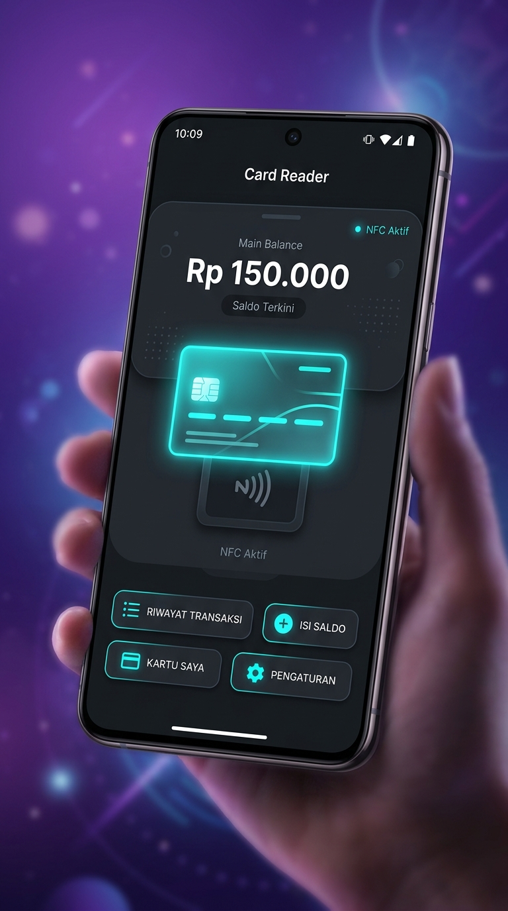
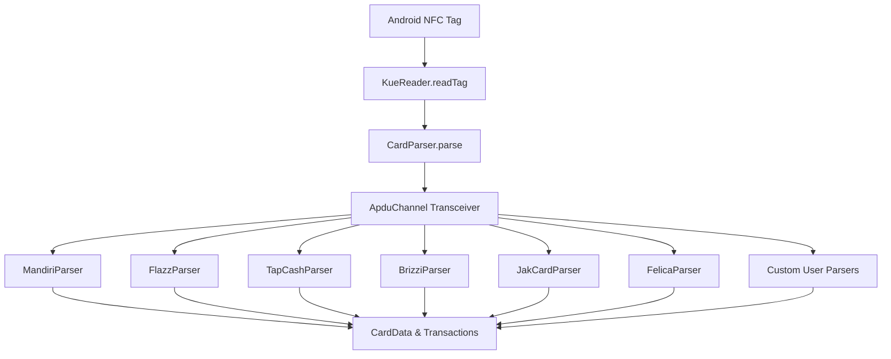

# KUE Reader SDK — Indonesian Contactless Card (NFC) Toolkit for Android

<p align="center">
  
</p>

<p align="center">
  <strong>Lightweight, modular, and privacy-preserving Android SDK for reading Indonesian contactless electronic money cards via NFC.</strong><br>
  Built with Kotlin & modern Android NFC architecture.
</p>

<p align="center">
  <a href="https://github.com/muhakmal/osp-kue-reader/actions/workflows/ci.yml"></a>
  <a href="https://jitpack.io/#muhakmal/osp-kue-reader"></a>
  <a href="LICENSE"></a>
  
  
  
  <a href="CONTRIBUTING.md"></a>
</p>

---

## 🌟 Production Showcase: Pembaca KUE

> [!NOTE]
> **Battle-Tested in Production**  
> This SDK is the core open-source engine powering **[Pembaca KUE](https://play.google.com/store/apps/details?id=com.baskom.pembacakue)**, the top-rated Indonesian electronic money card reader app on Google Play with thousands of active card scans daily.
>
> If you are looking for a ready-to-use end-user application with sound announcements, expense tracking, and toll calculators, install **Pembaca KUE**. If you are a developer looking to integrate electronic money reading into your own app, use this **KUE Reader SDK**!

<p align="center">
  
</p>

---

## 📖 Table of Contents
- [Features](#-features)
- [Supported Cards](#-supported-cards)
- [Installation](#-installation)
- [Quick Start](#-quick-start)
- [Sample Application](#-sample-application)
- [Architecture & Extensibility](#-architecture--extensibility)
- [Privacy & Security](#-privacy--security)
- [Disclaimer & Trademarks](#-disclaimer--trademarks)
- [Contributing & License](#-contributing--license)

---

## ⚡ Features

- **🚀 Ultra Lightweight (~56 KB AAR)**: Zero heavy third-party runtime dependencies. Only relies on core Android NFC APIs and Kotlin Coroutines.
- **🛡️ 100% Offline & Private**: Zero network permissions required. Card data and balances are decoded strictly on-device.
- **🔒 Strictly Read-Only**: Implements standard read APDU commands (`SELECT`, `READ RECORD`, `READ BINARY`). Never attempts write operations or cryptographic tampering.
- **🔌 Pluggable Parser Pipeline**: Add support for new transit cards or proprietary applets using the `EmoneyParser` interface and `ApduChannel` test abstractions.
- **🧪 Comprehensive Unit Test Suite**: Includes mock APDU channel fixtures for regression testing without physical NFC cards.

---

## 💳 Supported Cards

| Card Type | Issuer | Protocol / Standard | Balance | History | Notes |
|:---|:---|:---:|:---:|:---:|:---|
| **Mandiri e-money** | Bank Mandiri | ISO/IEC 14443-4 (IsoDep) | ✅ | ✅ | Supports new (`00 D1`) and legacy records |
| **BCA Flazz (Gen 2)** | Bank Central Asia | ISO/IEC 14443-4 (IsoDep) | ✅ | ✅ | Full balance & recent merchant/transit log |
| **BCA Flazz (Gen 1)** | Bank Central Asia | ISO/IEC 14443-4 (IsoDep) | ⚠️ Encrypted | ⚠️ Encrypted | Requires proprietary bank SAM |
| **BNI TapCash** | Bank Negara Indonesia | ISO/IEC 14443-4 (IsoDep) | ✅ | ✅ | Reads balance & terminal transaction log |
| **BRI Brizzi** | Bank Rakyat Indonesia | ISO/IEC 14443-4 (IsoDep) | ✅ | ✅ | DESFire wrapped native records |
| **JakCard** | Bank DKI | ISO/IEC 14443-4 (IsoDep) | ✅ | ✅ | Jakarta transit & public transport card |
| **KMT (Kartu Multi Trip)**| PT KCI | JIS X 6319-4 (FeliCa) / Mifare | ✅ | ✅ | Commuter Line & MRT Jakarta |

---

## 📦 Installation

Add JitPack to your project repository settings:

### Gradle (Kotlin DSL)
```kotlin
// settings.gradle.kts
dependencyResolutionManagement {
    repositories {
        google()
        mavenCentral()
        maven { url = uri("https://jitpack.io") }
    }
}

// build.gradle.kts (app module)
dependencies {
    implementation("com.github.muhakmal:osp-kue-reader:1.0.0")
}
```

### Gradle (Groovy)
```groovy
// settings.gradle or root build.gradle
allprojects {
    repositories {
        google()
        mavenCentral()
        maven { url 'https://jitpack.io' }
    }
}

// build.gradle
dependencies {
    implementation 'com.github.muhakmal:osp-kue-reader:1.0.0'
}
```

---

## 🚀 Quick Start

### 1. Basic Card Reading
When an Android NFC `Tag` is discovered:

```kotlin
import io.github.muhakmal.kuereader.KueReader
import io.github.muhakmal.kuereader.model.CardData

// In your Activity / NFC reader callback:
val cardData: CardData? = KueReader.readTag(tag)

if (cardData != null && cardData.isBalanceReadable) {
    Log.d("KueReader", "Detected: ${cardData.cardName}")
    Log.d("KueReader", "Balance: Rp ${cardData.balance}")
    Log.d("KueReader", "Card UID: ${cardData.rawId}")

    for (tx in cardData.transactionHistory) {
        Log.d("KueReader", "${tx.date} | ${tx.type} | Rp ${tx.amount} | ${tx.location}")
    }
} else {
    Log.w("KueReader", "Card not recognized or balance unreadable.")
}
```

### 2. Using `NfcManager` in an Activity
The SDK includes an optional lifecycle helper for Reader Mode:

```kotlin
class ScanActivity : ComponentActivity() {

    private lateinit var nfcManager: NfcManager

    override fun onCreate(savedInstanceState: Bundle?) {
        super.onCreate(savedInstanceState)
        nfcManager = NfcManager(this)

        lifecycleScope.launch {
            nfcManager.nfcTags.collectLatest { tag ->
                val card = KueReader.readTag(tag)
                // Update UI state with card data
            }
        }
    }

    override fun onResume() {
        super.onResume()
        nfcManager.enableReaderMode(this)
    }

    override fun onPause() {
        super.onPause()
        nfcManager.disableReaderMode(this)
    }
}
```

---

## 📱 Sample Application

A reference Android Jetpack Compose application is available in the [`:sample`](sample/) directory.

To build and run the sample application on a physical device:
```bash
./gradlew :sample:installDebug
# or: make build
```

---

## 🏛️ Architecture & Extensibility



### Adding a Custom Card Parser
You can implement the `EmoneyParser` interface and register your custom parser at runtime:

```kotlin
class MyCustomTransitParser : EmoneyParser {
    override fun canHandle(tag: Tag): Boolean {
        return tag.techList.contains(IsoDep::class.java.name)
    }

    override fun parse(tag: Tag, logBuilder: StringBuilder): CardData? {
        val isoDep = CardParser.getSharedIsoDep(tag) ?: return null
        val channel = isoDep.asChannel()
        // Send APDU commands and parse balance
        return CardData("My Custom Card", balance = 50000.0)
    }
}

// Register with the SDK:
KueReader.registerCustomParser(MyCustomTransitParser())
```

---

## 🔒 Privacy & Security

- **Strictly On-Device**: All card reads happen in-memory on the user's device. The library contains no telemetry, analytics, or network permissions.
- **Read-Only**: The SDK never sends write APDU commands or modifies card data.

---

## ⚖️ Disclaimer & Trademarks

1. **Non-Affiliation**: This SDK is an independent open-source library. It is not affiliated with, endorsed by, or sponsored by Bank Mandiri, Bank Central Asia (BCA), Bank Negara Indonesia (BNI), Bank Rakyat Indonesia (BRI), Bank DKI, or PT Kereta Commuter Indonesia.
2. **Trademarks**: *Mandiri e-money*, *Flazz*, *TapCash*, *Brizzi*, *JakCard*, and *KMT* are trademarks of their respective banking and transit institutions.
3. **No Warranty**: Distributed under the [Apache License 2.0](LICENSE) on an "AS IS" basis.

---

## 🤝 Contributing & Roadmap
- See [CONTRIBUTING.md](CONTRIBUTING.md) for contribution guidelines and testing practices.
- See [ROADMAP.md](ROADMAP.md) for planned features and upcoming card protocol additions.

## 📄 License
This project is licensed under the [Apache License 2.0](LICENSE).
